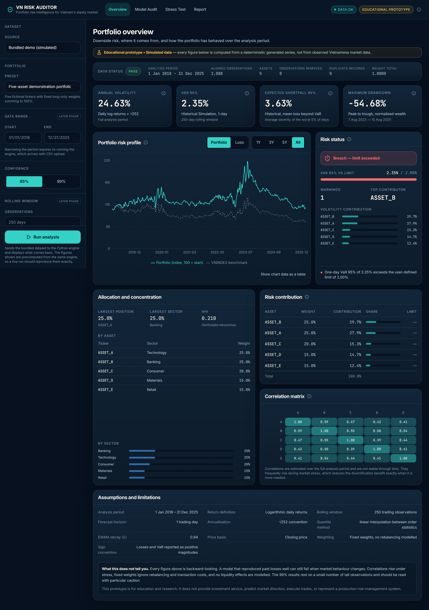
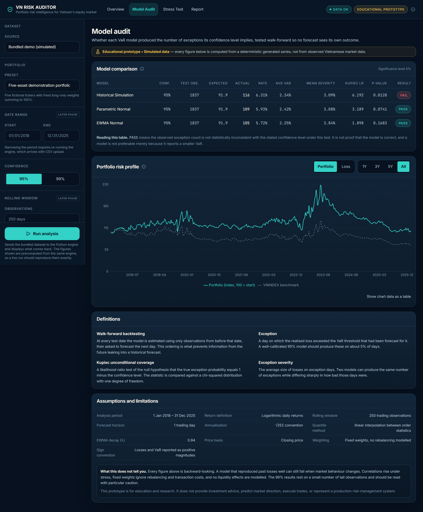
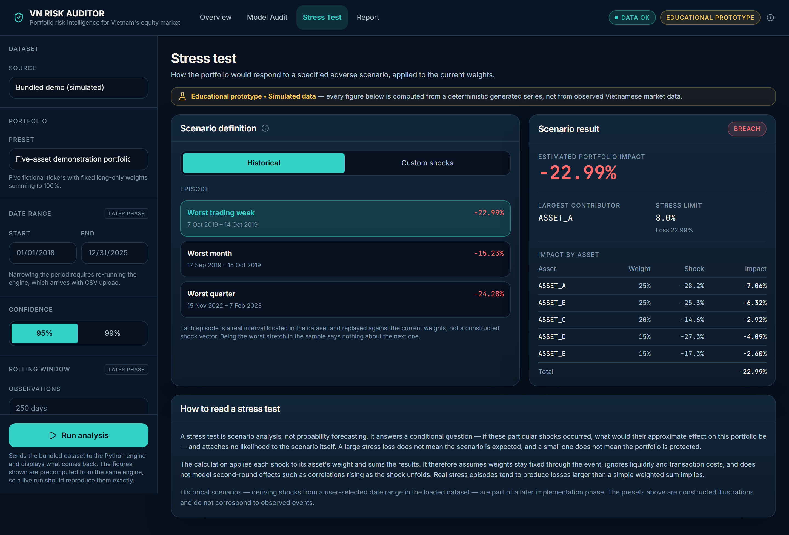
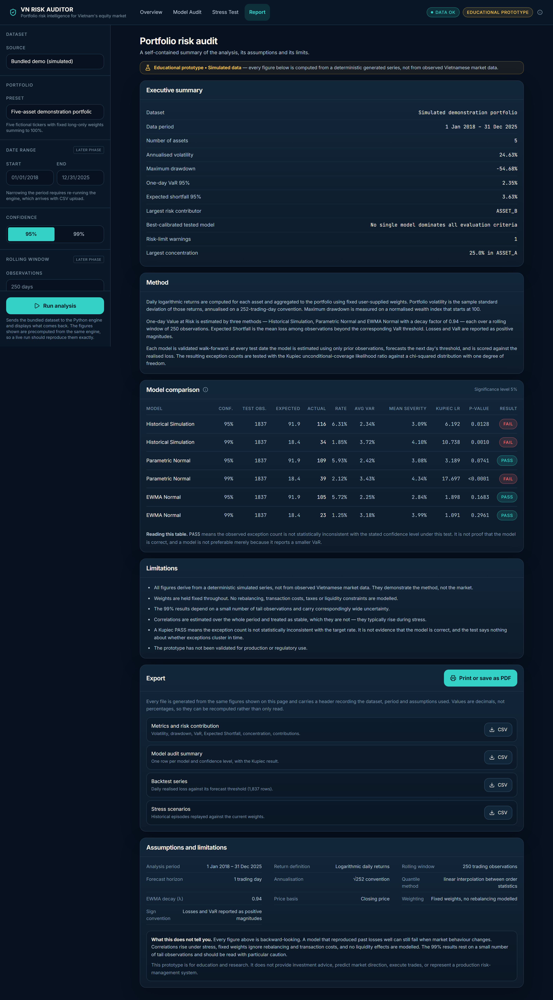

# Hướng dẫn sử dụng VN Portfolio Risk Auditor

Tài liệu này hướng dẫn cách dùng trang web: mỗi trang hiển thị gì, các nút
điều khiển làm gì, cách tải dữ liệu của riêng bạn lên, và cách đọc các con
số. Không cần biết lập trình để làm theo.

> **Nguyên mẫu phục vụ học tập — dữ liệu mô phỏng.** Bộ dữ liệu có sẵn là
> chuỗi giá **giả lập** với các mã hư cấu (`ASSET_A` … `ASSET_E`), không phải
> dữ liệu thị trường Việt Nam thật. Công cụ không đưa ra lời khuyên đầu tư,
> không dự báo giá và không thực hiện giao dịch.

---

## Mục lục

1. [Truy cập](#1-truy-cập)
2. [Bố cục chung](#2-bố-cục-chung)
3. [Trang Overview — Tổng quan](#3-trang-overview--tổng-quan)
4. [Trang Model Audit — Kiểm định mô hình](#4-trang-model-audit--kiểm-định-mô-hình)
5. [Trang Stress Test — Kiểm tra sức chịu đựng](#5-trang-stress-test--kiểm-tra-sức-chịu-đựng)
6. [Trang Report — Báo cáo và xuất file](#6-trang-report--báo-cáo-và-xuất-file)
7. [Tải dữ liệu của bạn lên](#7-tải-dữ-liệu-của-bạn-lên)
8. [Cách đọc kết quả](#8-cách-đọc-kết-quả)
9. [Câu hỏi thường gặp và xử lý lỗi](#9-câu-hỏi-thường-gặp-và-xử-lý-lỗi)
10. [Giới hạn của công cụ](#10-giới-hạn-của-công-cụ)

---

## 1. Truy cập

Mở **https://vnportfolioriskauditor.vercel.app** bằng trình duyệt bất kỳ
(Chrome, Edge, Firefox, Safari). Không cần đăng ký hay đăng nhập.

Bộ dữ liệu demo đã được tính sẵn và hiển thị ngay khi trang tải xong — không
cần chờ máy chủ. Máy chủ phân tích (backend) chỉ được gọi khi bạn bấm
**Run analysis** hoặc tải file CSV của riêng mình lên.

Trang web dùng được trên điện thoại, nhưng màn hình máy tính (rộng từ 1280px)
cho trải nghiệm tốt nhất, vì các bảng và biểu đồ có nhiều cột.

---

## 2. Bố cục chung

Mọi trang đều có ba phần:

**Thanh tiêu đề (trên cùng)**
- Logo **VN RISK AUDITOR** — bấm để về trang Overview.
- Bốn mục điều hướng: **Overview**, **Model Audit**, **Stress Test**,
  **Report**. Trên điện thoại, vuốt ngang để thấy đủ bốn mục.
- Huy hiệu **Data OK** và **Educational prototype**, cùng biểu tượng (i) giải
  thích phạm vi của công cụ.

**Thanh điều khiển (bên trái)** — áp dụng cho tất cả các trang:

| Mục | Chức năng | Trạng thái |
|---|---|---|
| **Dataset → Source** | Chọn **Bundled demo (simulated)** (dữ liệu demo) hoặc **Upload CSV** (dữ liệu của bạn) | Dùng được |
| **Portfolio → Preset** | Danh mục demo 5 tài sản | Chỉ có một lựa chọn |
| **Date range** | Khoảng thời gian phân tích | Bị khóa, nhãn *Later phase* |
| **Confidence** | Mức tin cậy **95%** hoặc **99%** | Dùng được |
| **Rolling window** | Số ngày dùng để ước lượng mỗi dự báo (mặc định 250) | Bị khóa, nhãn *Later phase* |
| **Model** | Bật/tắt ba mô hình VaR trong bảng kiểm định | Dùng được |
| **Advanced assumptions** | Hệ số EWMA λ, chỉ số tham chiếu, và **Simulated notional** (giá trị danh mục giả định) | Chỉ ô *Simulated notional* dùng được |
| **Run analysis** | Gửi dữ liệu demo cho engine Python tính lại | Dùng được ở chế độ demo |

Các điều khiển có nhãn *Later phase* hiển thị để cho thấy thiết kế đầy đủ,
nhưng chưa thay đổi được trong phiên bản này.

**Simulated notional**: nhập một số tiền (ví dụ `1000000000` cho 1 tỷ đồng)
thì kết quả stress test sẽ hiện thêm số tiền lỗ tương ứng, bên cạnh tỷ lệ
phần trăm. Để trống nếu chỉ muốn xem phần trăm.

**Biểu tượng (i)** xuất hiện cạnh hầu hết các chỉ số và bảng. Rê chuột (hoặc
chạm trên điện thoại) để đọc định nghĩa ngắn gọn.

---

## 3. Trang Overview — Tổng quan



Trang này trả lời: danh mục có rủi ro bao nhiêu, và rủi ro đến từ đâu.

**Dải chất lượng dữ liệu** (ngay dưới tiêu đề) — kỳ phân tích, số quan sát
sau khi căn chỉnh ngày, số tài sản, số dòng bị loại, số bản ghi trùng, tổng
tỷ trọng. Huy hiệu **PASS / WARNING / FAIL** cho biết dữ liệu có vấn đề gì
không. Hãy xem dải này trước khi tin vào bất kỳ con số nào bên dưới.

**Bốn thẻ chỉ số chính**

| Thẻ | Giá trị demo | Ý nghĩa ngắn gọn |
|---|---:|---|
| Annual volatility | 24,63% | Mức dao động của danh mục, quy ra năm |
| VaR 95% | 2,35% | Ngưỡng lỗ một ngày: khoảng 5/100 ngày lỗ vượt mức này |
| Expected shortfall 95% | 3,63% | Mức lỗ trung bình *trong* những ngày tệ nhất đó |
| Maximum drawdown | −54,68% | Mức sụt giảm lớn nhất từ đỉnh xuống đáy |

**Biểu đồ Risk profile** — có hai chế độ xem:
- **Portfolio**: giá trị danh mục chuẩn hóa (bắt đầu từ 100), so với chỉ số
  tham chiếu VNINDEX.
- **Loss**: lỗ thực tế từng ngày so với ngưỡng VaR đã dự báo cho ngày đó; các
  ngày vượt ngưỡng (exception) được đánh dấu.

Các nút **1Y / 3Y / 5Y / All** thu hẹp khoảng thời gian hiển thị.

**Bảng trạng thái rủi ro (Risk status)** — so các chỉ số với hạn mức đặt sẵn:

| Hạn mức | Giá trị |
|---|---:|
| VaR 95% tối đa | 2% |
| Tỷ trọng tối đa một tài sản | 30% |
| Tỷ trọng tối đa một ngành | 45% |
| Mức lỗ stress test tối đa | 8% |

Trạng thái là **Within limit** (trong hạn mức), **Warning** (sắp chạm) hoặc
**Breach** (vượt). Với dữ liệu demo, trạng thái là **Breach** vì VaR 2,35%
vượt hạn mức 2%. Đây là so sánh với hạn mức, *không phải* đánh giá danh mục
tốt hay xấu.

**Các bảng phía dưới**
- **Allocation** — tỷ trọng theo tài sản và theo ngành, kèm chỉ số tập trung.
- **Risk contribution** — mỗi tài sản đóng góp bao nhiêu phần trăm vào tổng
  rủi ro. Ví dụ: `ASSET_B` chỉ chiếm 25% tỷ trọng nhưng đóng góp gần 30% rủi
  ro.
- **Correlation heatmap** — mức độ các tài sản biến động cùng chiều với nhau.
- **Assumptions** (cuối trang) — các giả định đã dùng để tính toán.

---

## 4. Trang Model Audit — Kiểm định mô hình



Đây là phần mà hầu hết công cụ khác bỏ qua: kiểm tra xem **bản thân mô hình
rủi ro có đáng tin không**.

Công cụ so sánh ba cách ước lượng VaR:
- **Historical Simulation** — dựa trực tiếp vào phân phối lợi suất quá khứ.
- **Parametric Normal** — giả định lợi suất có phân phối chuẩn.
- **EWMA Normal** — giống Parametric Normal nhưng đặt trọng số lớn hơn cho dữ
  liệu gần đây (λ = 0,94).

Mỗi mô hình được kiểm tra theo kiểu **walk-forward**: tại mỗi ngày, mô hình
chỉ được dùng dữ liệu *trước* ngày đó để dự báo, rồi so với mức lỗ thực tế.

**Bảng kiểm định** — mỗi dòng là một cặp mô hình × mức tin cậy:

| Cột | Ý nghĩa |
|---|---|
| Test obs. | Số ngày được kiểm tra (1.837 với dữ liệu demo) |
| Expected | Số ngày vượt ngưỡng *kỳ vọng* (5% hoặc 1% số ngày) |
| Actual | Số ngày vượt ngưỡng *thực tế* |
| Rate | Tỷ lệ vượt ngưỡng thực tế |
| Avg VaR | Ngưỡng VaR trung bình |
| Mean severity | Mức lỗ trung bình trong các ngày vượt ngưỡng |
| Kupiec LR, p-value | Thống kê kiểm định Kupiec |
| Result | **PASS** hoặc **FAIL** |

**Cách tương tác**
- Bỏ chọn mô hình ở mục **Model** trên thanh bên trái để ẩn dòng tương ứng.
- Chọn **99%** ở mục **Confidence** để xem kết quả ở mức tin cậy cao hơn.
- Chuyển biểu đồ sang chế độ **Loss** để thấy các ngày vượt ngưỡng trên trục
  thời gian.

Phần **Definitions** cuối trang giải thích các thuật ngữ: walk-forward,
exception, kiểm định Kupiec, mức độ nghiêm trọng.

---

## 5. Trang Stress Test — Kiểm tra sức chịu đựng



Trang này trả lời câu hỏi *"nếu điều này xảy ra thì sao"* — không phải *"điều
này có khả năng xảy ra không"*.

Chọn một trong hai chế độ:

**Historical** — phát lại các giai đoạn tệ nhất có trong bộ dữ liệu, áp lên tỷ
trọng hiện tại. Bấm vào từng giai đoạn để xem chi tiết:

| Giai đoạn | Thời gian | Tác động lên danh mục |
|---|---|---:|
| Worst trading week | 07/10/2019 – 14/10/2019 | −22,99% |
| Worst month | 17/09/2019 – 15/10/2019 | −15,23% |
| Worst quarter | 15/11/2022 – 07/02/2023 | −24,28% |

**Custom shocks** — tự đặt cú sốc giá cho từng tài sản bằng thanh trượt (từ
−40% đến +20%). Kết quả cập nhật ngay khi kéo. Bấm **Reset** để đưa tất cả về
−8%.

**Bảng Scenario result** (bên phải) hiển thị:
- **Estimated portfolio impact** — tác động ước tính lên toàn danh mục. Nếu đã
  nhập *Simulated notional*, số tiền tương ứng hiện bên dưới.
- **Largest contributor** — tài sản gây lỗ nhiều nhất.
- **Stress limit** — so với hạn mức 8%; huy hiệu cho biết trong hạn mức, cảnh
  báo hay vượt.
- **Impact by asset** — tỷ trọng × cú sốc = tác động của từng tài sản.

Phép tính là tổng có trọng số đơn giản: giả định tỷ trọng không đổi suốt sự
kiện, bỏ qua thanh khoản và chi phí giao dịch. Trong khủng hoảng thật, thiệt
hại thường lớn hơn con số này.

---

## 6. Trang Report — Báo cáo và xuất file



Bản tóm tắt độc lập của toàn bộ phân tích, có thể in hoặc gửi cho người khác.

**Nội dung**
- **Executive summary** — các con số chính trên một bảng, bao gồm mô hình
  được hiệu chỉnh tốt nhất trong số các mô hình đã kiểm định.
- **Method** — mô tả phương pháp tính.
- **Bảng kiểm định mô hình** đầy đủ.
- **Limitations** — các giới hạn cần lưu ý khi đọc kết quả.

**Xuất file**
- **Print or save as PDF** — mở hộp thoại in của trình duyệt. Chọn *Save as
  PDF* (Lưu dưới dạng PDF) làm máy in để lưu file PDF.
- Bốn nút **CSV** tải về:

| File | Nội dung |
|---|---|
| Metrics and risk contribution | Volatility, drawdown, VaR, ES, chỉ số tập trung, đóng góp rủi ro |
| Model audit summary | Mỗi dòng một cặp mô hình × mức tin cậy, kèm kết quả Kupiec |
| Backtest series | Lỗ thực tế từng ngày so với ngưỡng dự báo |
| Stress scenarios | Các giai đoạn lịch sử áp lên tỷ trọng hiện tại |

Giá trị trong file CSV là **số thập phân** (0,0235 thay vì 2,35%) để có thể
dùng tính toán lại. Mỗi file có phần đầu ghi bộ dữ liệu, kỳ phân tích và giả
định đã dùng.

---

## 7. Tải dữ liệu của bạn lên

### Các bước

1. Ở thanh bên trái, mục **Dataset → Source**, chọn **Upload CSV**.
2. Ở ô **Market data**, chọn file giá thị trường.
3. Ở ô **Portfolio**, chọn file danh mục.
4. Bấm **Analyse uploaded files**.
5. Chờ kết quả. Lần đầu có thể mất **tới khoảng một phút** nếu máy chủ đang
   "ngủ" (cold start); những lần sau nhanh hơn.
6. Khi xong, mọi trang hiển thị kết quả từ dữ liệu của bạn, và thông báo
   *Analysing uploaded data* thay cho nhãn *Simulated data*.
7. Bấm **Back to bundled demo** để quay lại dữ liệu demo.

Cách nhanh nhất để thử là tải hai file demo về, sửa, rồi tải lên lại:
- [market_data.csv](https://vnportfolioriskauditor.vercel.app/demo/market_data.csv)
- [portfolio.csv](https://vnportfolioriskauditor.vercel.app/demo/portfolio.csv)

### File giá thị trường (Market data)

Dạng "dài": **mỗi dòng là một mã trong một ngày giao dịch**.

| Cột | Bắt buộc | Mô tả |
|---|---|---|
| `date` | Có | Ngày giao dịch, định dạng `YYYY-MM-DD` (ví dụ `2024-03-15`) |
| `ticker` | Có | Mã chứng khoán. Tự động viết hoa và bỏ khoảng trắng |
| `close` | Có | Giá đóng cửa, phải là số dương |
| `adjusted_close` | Không | Giá điều chỉnh. Nếu có thì được ưu tiên dùng thay `close` |
| `volume` | Không | Khối lượng. Không dùng trong tính toán |
| `sector` | Không | Ngành. Nếu thiếu thì ghi là `Unclassified` |

```csv
date,ticker,close,volume,sector
2018-01-01,ASSET_A,99.91,2241650,Technology
2018-01-01,ASSET_B,83.48,1604834,Banking
2018-01-01,VNINDEX,961.86,0,Benchmark
```

Thêm dòng `VNINDEX` nếu muốn có đường tham chiếu trên biểu đồ.

### File danh mục (Portfolio)

| Cột | Bắt buộc | Mô tả |
|---|---|---|
| `ticker` | Có | Mã chứng khoán, phải có trong file giá |
| `weight` | Có | Tỷ trọng, dạng thập phân từ 0 đến 1 (25% ghi là `0.25`) |
| `sector` | Không | Ngành |

```csv
ticker,weight,sector
ASSET_A,0.25,Technology
ASSET_B,0.25,Banking
ASSET_C,0.20,Consumer
ASSET_D,0.15,Materials
ASSET_E,0.15,Retail
```

### Quy tắc dữ liệu

- Tổng tỷ trọng phải bằng **1** (sai số cho phép 0,000001).
- Không có tỷ trọng âm — phiên bản này chỉ hỗ trợ danh mục mua (long-only).
- Danh mục có từ **2 đến 10** tài sản.
- Mỗi mã trong danh mục phải có trong file giá.
- Dùng dấu chấm cho số thập phân (`0.25`, không phải `0,25`).
- Dung lượng tối đa mỗi file: **8 MB**.
- Cần ít nhất **251 ngày** giao dịch chung giữa các mã (250 ngày cửa sổ + 1).
  Dưới 350 ngày vẫn chạy được nhưng có cảnh báo dữ liệu mỏng.

**Cách xử lý dữ liệu thiếu**: công cụ chỉ giữ những ngày mà *tất cả* các mã
trong danh mục đều có giá. Ngày nào thiếu giá của một mã sẽ bị bỏ cho mọi mã.
Giá thiếu **không bao giờ** được tự điền bằng giá ngày trước.

**Quyền riêng tư**: file tải lên được xử lý trong bộ nhớ rồi bị hủy ngay. Không
có gì được ghi xuống đĩa hay lưu lại.

### Những gì khác khi dùng dữ liệu của bạn

- Chế độ **Historical** trên trang Stress Test không có dữ liệu, vì các giai
  đoạn lịch sử chỉ được tính sẵn cho bộ demo. Chế độ **Custom shocks** vẫn
  dùng được.
- Vì vậy nút xuất **Stress scenarios** trên trang Report bị vô hiệu.
- Nút **Run analysis** chỉ dùng cho bộ demo; với dữ liệu riêng, dùng nút
  **Analyse uploaded files**.

---

## 8. Cách đọc kết quả

**VaR (Value at Risk) và Expected Shortfall** — VaR 95% bằng 2,35% nghĩa là:
khoảng 95 trong 100 ngày, danh mục lỗ không quá 2,35%. Nhưng VaR **không** cho
biết 5 ngày còn lại tệ đến mức nào. Expected Shortfall trả lời câu đó: trung
bình những ngày tệ nhất lỗ 3,63%. Khoảng cách giữa hai con số càng lớn thì
"đuôi" rủi ro càng nặng.

**Maximum drawdown** — nếu nắm giữ suốt kỳ, đây là mức sụt giảm sâu nhất bạn
phải chịu từ một đỉnh trước đó. Với dữ liệu demo là −54,68%, nghĩa là có lúc
danh mục mất hơn một nửa giá trị so với đỉnh.

**Risk contribution** — một tài sản có thể chiếm tỷ trọng nhỏ nhưng đóng góp
rủi ro lớn, nếu nó biến động mạnh hoặc tương quan cao với các tài sản khác.
Tổng đóng góp luôn bằng 100%.

**PASS / FAIL của kiểm định Kupiec**
- **PASS**: số ngày vượt ngưỡng thực tế *không mâu thuẫn* về mặt thống kê với
  con số kỳ vọng (p-value ≥ 0,05). Điều này **không** chứng minh mô hình đúng.
- **FAIL**: số ngày vượt ngưỡng khác biệt đáng kể so với kỳ vọng. Quá nhiều ⇒
  mô hình đánh giá thấp rủi ro; quá ít ⇒ mô hình quá thận trọng.

Ví dụ với dữ liệu demo ở mức 95%: Historical Simulation có 116 ngày vượt
ngưỡng so với 92 ngày kỳ vọng ⇒ **FAIL** (đánh giá thấp rủi ro). EWMA Normal
có 105 ngày ⇒ **PASS**.

**"Best-calibrated tested model"** trên trang Report là mô hình có tỷ lệ vượt
ngưỡng gần mục tiêu nhất trong số các mô hình PASS. Nếu hai mô hình gần như
ngang nhau, công cụ sẽ ghi *"No single model dominates all evaluation
criteria"* thay vì chọn bừa một cái. Công cụ không bao giờ chọn mô hình chỉ vì
nó cho ra VaR nhỏ nhất.

**Quy ước số liệu**
- Lỗ, VaR và Expected Shortfall là **số dương** (lỗ 2% ghi là 2%, không phải
  −2%). Drawdown là số âm.
- Lợi suất là lợi suất logarit; độ biến động quy ra năm theo 252 ngày giao
  dịch.
- Chỉ số nào không tính được sẽ hiện là **—**, không bao giờ hiện là 0.

---

## 9. Câu hỏi thường gặp và xử lý lỗi

**Bấm Run analysis thì các con số có thay đổi không?**
Không — và đó là điều cần kiểm chứng. Số liệu hiển thị sẵn chính là kết quả
của engine Python, được lưu lại. Bấm *Run analysis* để engine tính lại trực
tiếp; kết quả phải giống hệt. Đây là cách nhanh nhất để tự kiểm tra thay vì
tin lời.

**Bấm nút mà phải chờ lâu?**
Máy chủ miễn phí "ngủ" khi không có người dùng. Lần gọi đầu tiên sau một thời
gian có thể mất tới khoảng một phút. Đợi rồi thử lại.

**Tải file lên bị báo lỗi?**
Thông báo lỗi màu đỏ liệt kê từng vấn đề. Các lỗi thường gặp:

| Thông báo liên quan đến | Cách sửa |
|---|---|
| Tổng tỷ trọng (`WEIGHT_SUM`) | Chỉnh cột `weight` để tổng bằng đúng 1 |
| Tỷ trọng âm (`NEGATIVE_WEIGHT`) | Bỏ vị thế bán khống |
| Quá ít / quá nhiều tài sản | Danh mục phải có 2–10 mã |
| Mã không có trong dữ liệu giá (`TICKER_NOT_IN_MARKET_DATA`) | Kiểm tra chính tả mã, hoặc bổ sung giá cho mã đó |
| Tỷ trọng không phải số (`WEIGHT_NOT_NUMERIC`) | Dùng dấu chấm thập phân, bỏ ký hiệu `%` |
| Không đủ lịch sử (`INSUFFICIENT_HISTORY`) | Cần thêm dữ liệu — ít nhất 251 ngày chung |

**Mở file CSV bằng Excel bị lỗi định dạng?**
Excel trên máy cài tiếng Việt có thể dùng dấu phẩy làm dấu thập phân và đọc
sai file. Khi lưu file để tải lên, hãy chắc chắn file dùng dấu phẩy để ngăn
cột và dấu chấm cho số thập phân. Có thể mở bằng Notepad để kiểm tra.

**Kiểm tra máy chủ có đang chạy không?**
Mở https://vnportfolioriskauditor.vercel.app/api/v1/health — nếu thấy
`{"status":"ok", ...}` là máy chủ hoạt động bình thường. Kể cả khi máy chủ
không chạy, trang demo vẫn xem được đầy đủ.

---

## 10. Giới hạn của công cụ

- Dữ liệu demo là **mô phỏng**; kết quả minh họa phương pháp, không phản ánh
  thị trường thật.
- Tỷ trọng được giữ cố định; không mô phỏng tái cân bằng, phí giao dịch, thuế
  hay thanh khoản.
- Kết quả ở mức 99% dựa trên rất ít quan sát ở đuôi phân phối nên độ bất định
  lớn.
- Tương quan được ước lượng trên toàn kỳ và coi là ổn định — trong thực tế
  tương quan thường tăng mạnh khi thị trường căng thẳng.
- Kiểm định Kupiec không xét việc các ngày vượt ngưỡng có dồn cục theo thời
  gian hay không.
- Công cụ chưa được kiểm định cho mục đích vận hành thực tế hay tuân thủ quy
  định.

Chi tiết phương pháp xem [methodology.md](methodology.md); tài liệu kỹ thuật
xem [TAI-LIEU-KY-THUAT-VI.md](TAI-LIEU-KY-THUAT-VI.md).
